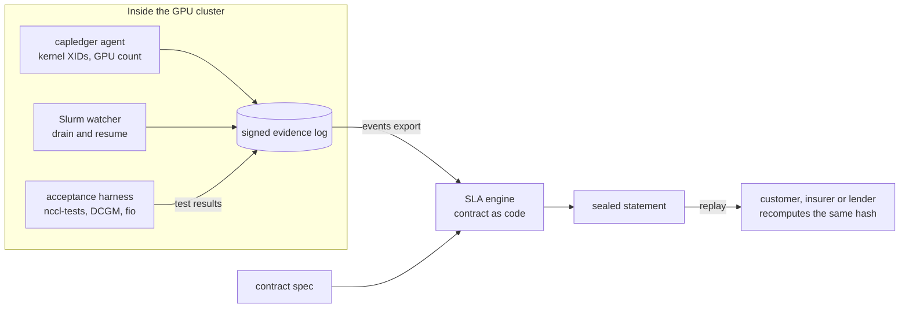

# Capacity Ledger

[](https://github.com/Sievehouse/capacity-ledger/actions/workflows/ci.yml)

**Contract-grade acceptance tests and SLA evidence for rented GPU clusters.**

Capacity Ledger gives a GPU provider, its customer and their financiers one neutral, replayable record of the capacity that was actually delivered: a signed acceptance report when a cluster is handed over, then a monthly SLA statement that either party can recompute from the same signed events and get the same hash.

> **Status: pre-alpha (v0.1.0).** The SLA engine, evidence log, XID agent and acceptance harness are implemented and tested on synthetic data. Nothing here has been validated on production GPU clusters yet. Example contracts are illustrative and are not legal advice.

## Why this exists

- **Delivered quality varies widely.** SemiAnalysis tested 77 GPU clouds for [ClusterMAX 3.0](https://newsletter.semianalysis.com/p/clustermax-30-the-industry-standard) (September 2026) and gave only 19 a medallion rating; its injected faults found health checks that missed failures or took hours to return nodes.
- **Contracts are standardising, measurement is not.** Providers and buyers now negotiate acceptance tests, downtime definitions and service credits, but each side measures with its own scripts and dashboards, so disputes are argued from support tickets.
- **Capital now needs the evidence.** Insurers sell parametric SLA cover and [lenders are starting to require it](https://capacityglobal.com/market-intelligence/data-centre-sla-risk-parametric-insurance-financing-2026/). A parametric trigger is only as good as the measurement behind it.
- **"Passed burn-in" is not "healthy".** ByteDance reports that synthetic microbenchmarks [miss over 60% of GPUs with silent data corruption](https://www.usenix.org/conference/osdi26/presentation/zheng), so acceptance has to be followed by continuous, comparable evidence.

## What is in v0.1

| Component | Language | What it does | Status |
| --- | --- | --- | --- |
| `capledger sla` | Go | Contract spec + events → sealed SLA statement; independent replay | Implemented; unit, property and CLI tests |
| `capledger evidence` | Go | Ed25519-signed, hash-chained JSONL log with an RFC 6962 Merkle root | Implemented; tamper tests |
| `capledger agent` | Go, stdlib only | Kernel log → NVIDIA XID/SXID observations → signed down events; optional GPU-count check | Implemented; tested on sample logs, not yet on GPU hosts |
| `deploy/slurm/slurm-state-watcher.sh` | Bash | Slurm drain and resume → signed down and up events | Tested against a fake `sinfo` |
| `capledger-harness plan / run / report` | Python | Acceptance plan (audit, DCGM, RDMA, NCCL, burn-in, storage), runner, per-node verdicts | Implemented; tested with simulated tool output |
| `capledger-harness localize-sim / outliers` | Python | Group-testing fault localisation; slow-node detection against peers | Implemented; tested in simulation |
| `harness/scripts/burnin.py` | Python, PyTorch | GEMMs and all-to-all traffic at the same time, per-rank results | Reference code; not yet run on hardware |

## Quickstart

Requirements: Go 1.22+ and Python 3.10+. The Go code has no third-party dependencies.

```bash
make build                              # bin/capledger
python3 -m venv .venv && . .venv/bin/activate
pip install -e "harness[dev]"           # capledger-harness
make test                               # Go and Python tests
./scripts/demo.sh                       # end-to-end on synthetic data, a few seconds
```

### Compute an SLA statement

```bash
./bin/capledger sla compute \
  --contract examples/contracts/hgx-16-node.json \
  --events   examples/events/hgx-16-node-2026-10.jsonl \
  --period 2026-10 --out statement.json --format text
```

```text
Contract      example-neocloud--example-lab--2026 (version 1)
Period        2026-10-01T00:00:00Z to 2026-11-01T00:00:00Z
Nodes         16 x 8 GPUs
Availability  99.7021%
Downtime      283.73 GPU-hours across 5 node(s); 16200 node-seconds excluded
Credit        5% (availability below 99.9%) = 15000.00 USD

Node            Downtime(s)  Excluded(s)  Incidents
gpu-003                8880            0  2026-10-03T04:12:00Z 8880s [node xid:79]
gpu-005                3600            0  2026-10-01T00:00:00Z 3600s [node xid:48]
gpu-010                   0        10800
gpu-011                7200            0  2026-10-20T01:00:00Z 7200s [node emergency-patch unannounced-maintenance]
gpu-012                   0         5400
gpu-014               14400            0  2026-10-25T12:00:00Z 14400s [node nccl-busbw-below-floor]
gpu-016               93600            0  2026-10-30T22:00:00Z 93600s [node network:rail-3-link-down]

statementSha256 d6280aea2086f9bf153922421dffbc4d44fbe17cc1106ba5184cad29f99323fc
```

Every number above is worked out by hand in [docs/sla-spec.md](docs/sla-spec.md).

### Replay it as the other party

```bash
./bin/capledger sla verify --statement statement.json \
  --contract examples/contracts/hgx-16-node.json \
  --events   examples/events/hgx-16-node-2026-10.jsonl
# replay OK: same inputs, same statement d6280aea...
```

### Record evidence on a node

```bash
./bin/capledger keygen --out keys
./bin/capledger agent --node gpu-003 --source kmsg --log evidence.jsonl --key keys/capledger.key.pem
./bin/capledger event emit --log evidence.jsonl --key keys/capledger.key.pem \
  --node gpu-003 --type up --cause node-reseated --source provider-health-check
./bin/capledger evidence verify --log evidence.jsonl --pub keys/capledger.pub.pem
./bin/capledger events export   --log evidence.jsonl --pub keys/capledger.pub.pem > events.jsonl
```

The agent only reads logs. It never resets GPUs, drains nodes or touches the scheduler; recovery events come from repair tooling, a health-check integration or the Slurm watcher.

### Plan an acceptance run

```bash
capledger-harness plan --inventory examples/inventory/hgx-4-node.yaml --out plan.json
capledger-harness run --plan plan.json --out results.jsonl --dry-run     # print every command
capledger-harness run --plan plan.json --out results.jsonl --stage audit --stage single_node
capledger-harness report --results results.jsonl --cluster example-hgx-32gpu --expected-gpus 8 \
  --criteria examples/criteria/hgx-h100-400g.yaml --out report.json --markdown report.md
capledger-harness localize-sim --nodes 64 --bad 2     # 2 bad nodes found in about 23 tests, not 2,016 pairs
```

## How it works



1. **Collect.** Agents, integrations and the harness append signed entries to per-source evidence logs. Each entry carries the hash of the previous one, so edits, deletions and reordering are detectable.
2. **Compute.** The SLA engine replays availability events against the contract spec: minimum incident length, scheduled-maintenance and customer-caused exclusions, a per-node exclusion cap, a rack rule for NVL72-style systems, and credit tiers. All arithmetic is exact (no floating point in the money path).
3. **Prove.** The statement is sealed with a SHA-256 over its canonical JSON and fingerprints its inputs. Anyone with the contract and the signed events gets the same statement.

Details: [architecture](docs/architecture.md), [SLA spec](docs/sla-spec.md), [acceptance tests](docs/acceptance-tests.md), [evidence format](docs/evidence-format.md), [threat model](docs/threat-model.md).

## Repository layout

```text
capacity-ledger/
├── cmd/capledger/            CLI: agent, sla, evidence, event(s), xid, keygen
├── internal/
│   ├── agent/                kernel-log follower, XID handling, GPU-count check
│   ├── canonical/            deterministic JSON for hashing
│   ├── contract/             contract SLA spec: load and validate
│   ├── events/               availability events: load, normalise, order
│   ├── evidence/             signed hash-chained log, keys, Merkle root
│   ├── interval/             exact interval-set arithmetic
│   ├── sla/                  SLA engine and sealed statements
│   └── xid/                  XID/SXID parsing and the starter policy
├── harness/                  Python acceptance harness (capledger-harness)
│   ├── src/capledger_harness/  plan, runner, report, baseline, localize, parsers
│   ├── scripts/burnin.py     PyTorch simultaneous GEMM + all-to-all burn-in
│   └── tests/
├── examples/                 contracts, events, inventory, criteria, sample tool output
├── deploy/                   Kubernetes DaemonSet, Dockerfile, Slurm watcher
├── docs/                     architecture, spec, tests, evidence, threats, roadmap
└── scripts/                  demo.sh, rename-module.sh
```

## Design principles

- **Deterministic money path.** Same inputs, same statement, same hash, on any machine. Integer seconds and exact rationals only.
- **Two vantage points.** Provider-side and tenant-side evidence should corroborate each other; neither party has to trust the other's dashboard. (Tenant-side probes are on the roadmap.)
- **Least privilege.** The agent is read-only, has no third-party dependencies and runs without root on most hosts.
- **Reuse proven tools.** nccl-tests, DCGM, perftest and fio do the measuring; this project orchestrates them, compares results and keeps the evidence.
- **No AI in verdicts or credits.** A wrong number here moves money. Language models may later draft incident summaries, always linked to the signed records.
- **Honest limits.** An acceptance report says "no defect found by these tests", never "no defect exists".

## Roadmap

Next: heartbeat entries and gap detection, a tenant-side probe, an AMD (amd-smi/RAS) collector, signed acceptance-report bundles, YAML contract specs read directly by the engine, then a hosted multi-party ledger with co-signed monthly statements. See [docs/roadmap.md](docs/roadmap.md), which also holds the 30-day validation plan this project is gated on.

## Contributing, security and licence

See [CONTRIBUTING.md](CONTRIBUTING.md) and [SECURITY.md](SECURITY.md). Licensed under the [Apache License 2.0](LICENSE).

If you renamed the repository, update the Go module path with `./scripts/rename-module.sh github.com/<you>/<repo>`.
