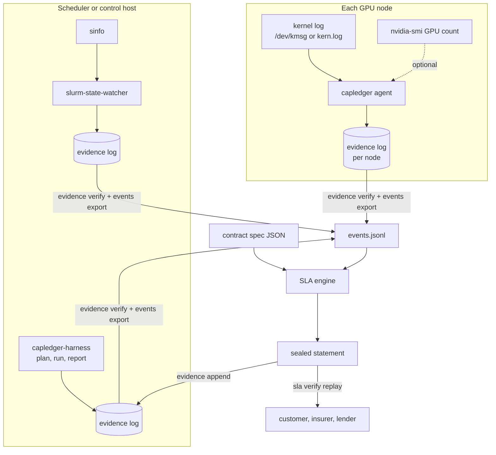

# Architecture

Capacity Ledger has two vantage points feeding one signed, replayable record. Only the SLA engine turns evidence into money, and it does so deterministically.

## Components

| Component | Responsibility | Not responsible for |
| --- | --- | --- |
| Agent | Parse XID/SXID kernel messages, record every one as a signed observation, emit `down` events for node-level faults per the policy, optionally detect missing GPUs | Remediation, draining, scheduling, closing incidents |
| Integrations (Slurm watcher; later Kubernetes, NVSentinel, ticketing) | Turn the provider's own repair and health state into `down` / `up` events | Deciding what the contract means |
| Acceptance harness | Plan and run standard tests, parse results, compare nodes with peers, localise faulty nodes, produce verdicts | Certifying the absence of defects |
| Evidence log | Append-only, hash-chained, signed JSON Lines; one writer per file | Storage, replication, retention (planned service) |
| SLA engine | Contract spec + events + period → statement with exact arithmetic; replay verification | Interpreting free-text contracts |

## Data flow and consistency

- **Single writer per log.** Each agent or integration owns its log file and key, so no locking or coordination is needed; logs merge at read time. Event ids embed the key id and sequence number, so they never collide.
- **Event ordering.** Time, then `seq`, then `id`. Integrations that can emit several transitions per second set `seq`.
- **Stateless agent.** Apart from the log itself, the agent keeps only a short suppression window in memory. A restart cannot invent data; it can only leave a gap (gap detection via heartbeats is on the roadmap).
- **Replayability.** A statement fingerprints the canonical contract and the sorted, normalised events and records the engine version. Replays with a different engine version are refused rather than silently compared.

## Technology choices

| Area | Choice | Reason |
| --- | --- | --- |
| Agent and engine | Go, standard library only | One static binary per platform; nothing to audit beyond this repository; easy for a counterparty to run a replay |
| Signatures | Ed25519 (`crypto/ed25519`), PKCS#8/PKIX PEM keys | Small, fast, deterministic signatures; no external libraries |
| Hashing | SHA-256 over canonical JSON with a domain prefix | Formatting changes cannot change hashes; hashes from different structures cannot collide by construction |
| Evidence commitment | RFC 6962 Merkle tree hash | Standard, simple, lets a statement commit to the exact evidence set |
| Harness | Python 3.10+, PyYAML | Test tooling and PyTorch live in Python; the harness only orchestrates proven tools |
| Arithmetic | Integer seconds, `math/big.Rat` | No floating point in anything that becomes money |

## Deployment shapes

- **Today (v0.1):** agent as a Kubernetes DaemonSet or systemd unit on each GPU node; Slurm watcher on the controller; the CLI wherever statements are computed or replayed.
- **Planned:** a hosted ledger service (PostgreSQL with append-only event tables plus object storage for raw results) giving provider, customer and financier roles read access to their own contracts, co-signing of monthly statements, and a self-hosted bundle for sovereign or air-gapped sites. A modular monolith, not microservices.

## Extension points

- XID policy files (`--policy`), versioned and recorded in every observation.
- New event sources: anything that can call `capledger event emit` or write the same signed entry format.
- Contract spec versions (`apiVersion`); the engine refuses unknown fields rather than guessing.
